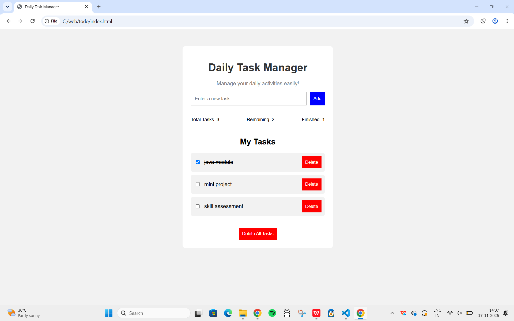

# Ex03 To-Do List using JavaScript
# Date: 17-11-2026

# AIM
To create a To-do Application with all features using JavaScript.

# ALGORITHM

STEP 1
Build the HTML structure (index.html).

STEP 2
Style the App (style.css).

STEP 3
Plan the features the To-Do App should have.

STEP 4
Create a To-do application using Javascript.

STEP 5
Add functionalities.

STEP 6
Test the App.

STEP 7
Open the HTML file in a browser to check layout and functionality.

STEP 8
Fix styling issues and refine content placement.

STEP 9
Deploy the website.

STEP 10
Upload to GitHub Pages for free hosting.

# PROGRAM
index.html
```

<!DOCTYPE html>
<html lang="en">
<head>
    <meta charset="UTF-8">
    <meta name="viewport" content="width=device-width, initial-scale=1.0">

    <title>Daily Task Manager</title>

    <link rel="stylesheet" href="style.css">
</head>

<body>

    <div class="container">

        <h1>Daily Task Manager</h1>

        <p class="subtitle">
            Manage your daily activities easily!
        </p>

        <div class="input-section">

            <input
                type="text"
                id="taskInput"
                placeholder="Enter a new task..."
            >

            <button id="addBtn">Add</button>

        </div>

        <div class="task-stats">

            <p>Total Tasks:
                <span id="totalCount">0</span>
            </p>

            <p>Remaining:
                <span id="pendingCount">0</span>
            </p>

            <p>Finished:
                <span id="completedCount">0</span>
            </p>

        </div>

        <h2>My Tasks</h2>

        <ul id="taskList"></ul>

        <button id="clearBtn" class="clear-btn">
            Delete All Tasks
        </button>

    </div>

    <script src="script.js"></script>

</body>
</html>
```
script.js
```

let tasks = [];

const taskInput = document.getElementById("taskInput");
const addBtn = document.getElementById("addBtn");
const taskList = document.getElementById("taskList");

const totalCount = document.getElementById("totalCount");
const pendingCount = document.getElementById("pendingCount");
const completedCount = document.getElementById("completedCount");

const clearBtn = document.getElementById("clearBtn");

// Update task counts
function updateStats() {

    let total = tasks.length;

    let completed = tasks.filter(
        task => task.completed === true
    ).length;

    let pending = total - completed;

    totalCount.innerText = total;
    pendingCount.innerText = pending;
    completedCount.innerText = completed;
}

// Display tasks
function displayTasks() {

    taskList.innerHTML = "";

    tasks.forEach(function(task, index) {

        let li = document.createElement("li");

        let checkbox = document.createElement("input");
        checkbox.type = "checkbox";
        checkbox.checked = task.completed;

        checkbox.addEventListener("change", function() {

            tasks[index].completed = checkbox.checked;

            displayTasks();

        });

        let span = document.createElement("span");
        span.innerText = task.name;

        if (task.completed) {
            span.style.textDecoration = "line-through";
        }

        let deleteBtn = document.createElement("button");
        deleteBtn.innerText = "Delete";

        deleteBtn.addEventListener("click", function() {

            tasks.splice(index, 1);

            displayTasks();

        });

        li.appendChild(checkbox);
        li.appendChild(span);
        li.appendChild(deleteBtn);

        taskList.appendChild(li);

    });

    updateStats();
}

// Add new task
function addTask() {

    let taskName = taskInput.value.trim();

    if (taskName === "") {

        alert("Please enter a task!");

        return;
    }

    tasks.push({

        name: taskName,
        completed: false

    });

    taskInput.value = "";

    displayTasks();
}

// Add button click
addBtn.addEventListener("click", addTask);

// Enter key support
taskInput.addEventListener("keypress", function(event) {

    if (event.key === "Enter") {

        addTask();

    }

});

// Delete all tasks
clearBtn.addEventListener("click", function() {

    tasks = [];

    displayTasks();

});

// Initial display
displayTasks();
```
style.cc
```

body {
    font-family: Arial, sans-serif;
    background-color: #f2f2f2;
    margin: 0;
    padding: 0;
}

.container {
    width: 400px;
    margin: 50px auto;
    padding: 25px;
    background-color: white;
    border-radius: 10px;
    text-align: center;
}

h1 {
    color: #333;
}

.subtitle {
    color: gray;
}

.input-section {
    display: flex;
    gap: 10px;
}

input[type="text"] {
    flex: 1;
    padding: 10px;
    font-size: 14px;
}

button {
    padding: 10px;
    background-color: blue;
    color: white;
    border: none;
    cursor: pointer;
}

button:hover {
    opacity: 0.8;
}

.task-stats {
    display: flex;
    justify-content: space-between;
    margin-top: 20px;
    font-size: 14px;
}

h2 {
    margin-top: 30px;
}

ul {
    list-style: none;
    padding: 0;
}

li {
    display: flex;
    align-items: center;
    justify-content: space-between;
    gap: 10px;
    background-color: #f2f2f2;
    padding: 10px;
    margin: 10px 0;
    border-radius: 5px;
}

li span {
    flex: 1;
    text-align: left;
    overflow-wrap: anywhere;
}

li button {
    background-color: red;
}

.clear-btn {
    background-color: red;
    margin-top: 20px;
}
```
# OUTPUT


# RESULT
The program for creating To-do list using JavaScript is executed successfully.